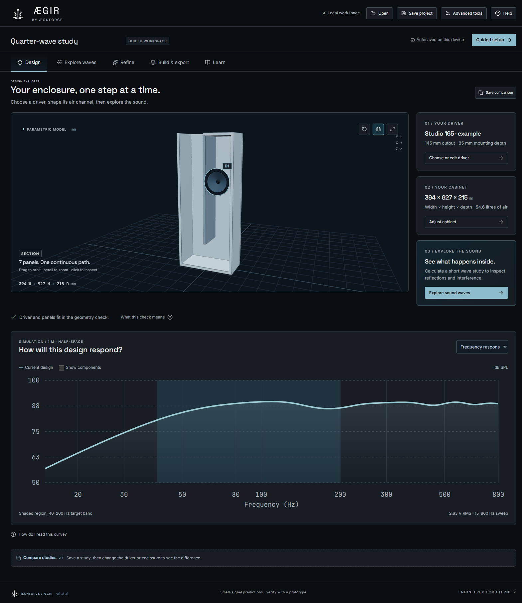
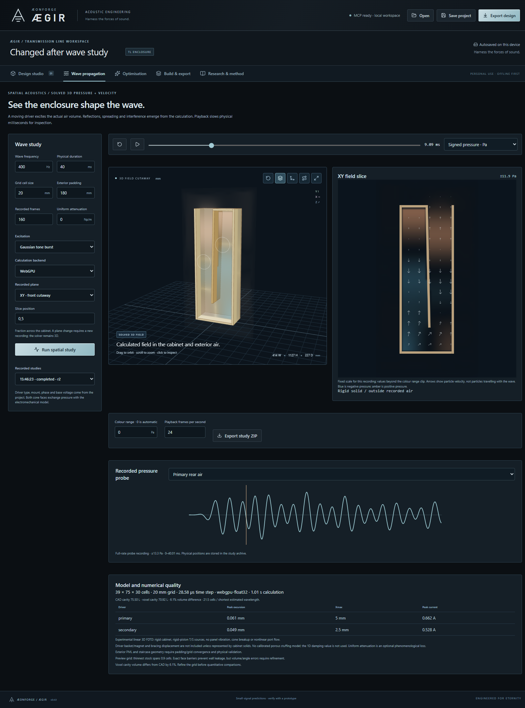
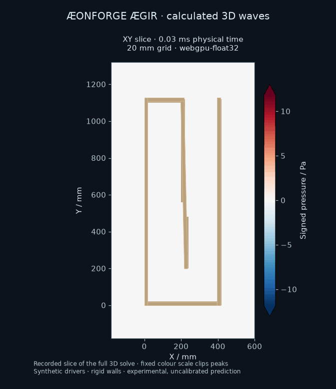
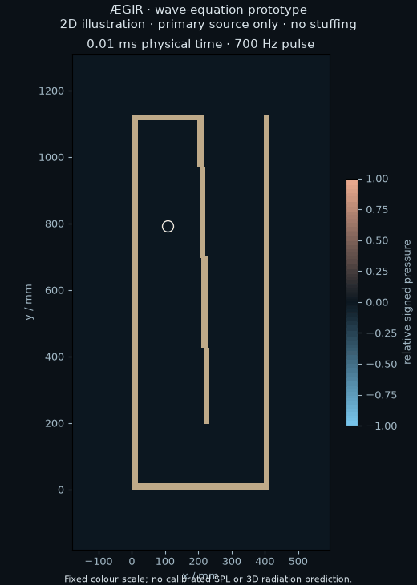

# ÆONFORGE ÆGIR

**Harness the forces of sound.** An ÆONFORGE acoustic engineering tool.

A local, source-available Electron app for designing **transmission-line loudspeaker enclosures** with editable baffles, variable clear sections and multiple coupled drivers. Enter a driver's Thiele–Small parameters, compare the coupled acoustic response, search constrained designs, inspect the folded cabinet in 3D, and export the panels for CAD/CAM.

No subscriptions, paid third-party software licences, cloud account or OpenAI API key are required for permitted personal use. Example drivers are **synthetic**, clearly identified, and editable. Replace them with measured or manufacturer specifications for your actual driver.

## Licence: personal noncommercial use only

The custom [AEGIR Personal Use and Contribution-Back License 1.0](LICENSE) permits **personal noncommercial use only**. Commercial and organisational use require separate written permission. **Every modification or purpose-built integration requires public corresponding source under the same licence and a pull-request submission to this repository**, including private personal modifications. Submit before non-development use/sharing and within 30 days of making the change. Acceptance or merging is not required. Ordinary private project/driver data and generated designs do not trigger contribution back.

This is **source-available, not OSI open source**. See [licensing details](docs/LICENSING.md), [contribution instructions](CONTRIBUTING.md) and the full LICENSE. Third-party licences remain unchanged.

## Run from source

Open `release/AEONFORGE-Aegir-0.6.0-x64.exe` after packaging, or use the unpacked executable in `release/win-unpacked/`. Install the optional CadQuery runtime with the setup command below if STEP export is needed. Generated binaries and private runtime profiles are excluded from this repository.

From source (Node 22.12+):

```powershell
git clone https://github.com/VelocityCubed/aegir.git
cd aegir
npm ci
npm run build
npm start
```

For development with hot reload: `npm run dev:desktop`. For a browser-only preview: `npm run dev`. Native file dialogs and direct STEP export require the Electron app; browser mode still downloads manufacturing bundles.

## Agent control through MCP

ÆGIR exposes the live desktop to MCP clients: projects, drivers, custom baffles, mouths, wave routes, coupled simulation, sweeps, optimisation, camera/graph controls, actual screenshots and direct fabrication exports. Agents and users edit the same persisted workspace with conflict detection, atomic edits and undo. See [setup, tools and example workflow](docs/MCP.md). No OpenAI API integration is needed; any compatible local stdio MCP client can supply the agent.

## Design workflow

The default workspace is guided. **Advanced tools** keeps the full engineering controls available and remembers your preference.

1. Open **Guided setup**. Keep the current driver, choose a clearly marked synthetic example, use a saved driver, or enter all measured/manufacturer data. Setup is a draft: cancel leaves the project unchanged.
2. Shape the cabinet with the live preview. Existing custom baffles, mouths, routes and other drivers are retained unless you explicitly choose a generated replacement. Review the fit before applying. A concurrent project edit cannot be silently overwritten.
3. On **Design**, inspect the cabinet and frequency response. **Choose or edit driver** and **Adjust cabinet** reopen the relevant setup step. Save comparisons to inspect alternatives. Use Advanced tools for individual baffles, routes, mounts, phase and full T/S controls.
4. On **Explore waves**, choose pulse or tone and frequency, then run a study and press Play. A completed study prioritizes the model; expand **Study settings** to change the calculation. The signed-pressure legend, optional air motion and **What am I seeing?** explain playback. **Appearance & playback** adjusts opacity, pressure-front shading and drawing quality without changing raw acoustic results. See [the field guide](docs/SPATIAL-FIELD.md).
5. On **Refine**, set the target band and size limits, find bounded candidates, then compare the trade-offs before applying one. Older wave studies keep their original geometry. Search scores are explicit and do not prove a global optimum.
6. On **Build & export**, review the panels and export the manufacturing ZIP, or optional STEP solids. Save the project JSON as a portable record. Add CAM settings, joinery and hardware in your fabrication workflow, then prototype and measure.

**Help** opens a searchable side panel you can read while working. **Learn** provides short walkthroughs and model limitations; it never starts a tour or blocks the workspace automatically.



## Export contents

| File | Purpose |
| --- | --- |
| `geometry-manifest.json` | Authoritative exact panel solid definitions, including clipped angled boards |
| `project.aegir.json` | Editable app project, driver and optimisation brief |
| `panels/*.stl` | Closed local panel meshes including through-cut driver hole; import as mm |
| `panels/*.dxf` | Millimetre panel outlines and circular holes on the CUT layer |
| `panels/*.svg` | 1:1 mm panel profiles |
| `assembly-reference.stl` | Positioned reference assembly of touching panel shells |
| `enclosure.scad` | OpenSCAD geometry snapshot |
| `enclosure.py` | Runnable CadQuery assembly snapshot, generates real STEP solids and panel STLs |
| `cut-list.csv` | Panel dimensions, thickness and quantities for one cabinet |
| `response.csv` | SPL components, impedance/phase, excursion, velocity, group delay |
| `BUILD-NOTES.txt` | Joinery, orientation, units, modelling assumptions and limitations |

**STL is a mesh format, not a cutting toolpath.** DXF/SVG are the useful 2D cutting outlines. Add cutter compensation/kerf, nesting, holding tabs, screw patterns, recesses and toolpaths in your chosen CAM software. No sheet nesting, G-code, cutter-radius offsets or fastening design is claimed. Front/back overlap the sides; caps and dividers fit between sides and between front/back. Keep the physical mouth open. Bottom mouths need a stand. Angled boards carry notes: stock face DXF/SVG outlines do not encode end mitres; use the exact 3D solid for machining/fitting.

## Optional STEP backend

The GUI's direct STEP export uses a local Python process with CadQuery. On Windows with Python 3.11+:

```powershell
npm run setup:cad
```

The app searches `AEGIR_PYTHON` (then legacy `WAVELAB_PYTHON`), this workspace's `.venv`, adjacent `cad-runtime` folders, a `.venv` in its launcher directory's parent/grandparent, its user-data `cad-runtime` folder, and finally `python` on PATH. `AEGIR_PYTHON` must be the **full Python executable path**, not a directory. Portable executable extraction is accounted for using `PORTABLE_EXECUTABLE_DIR`. Restart after installation. The CAD runtime is optional and is **not embedded** in the portable executable, keeping its distribution small.

Without the backend, every ZIP still includes a standalone script:

```powershell
python -m pip install cadquery==2.8.0
python enclosure.py cad-output
```

Or use `cad/export_step.py geometry-manifest.json enclosure.step`. The backend also accepts a raw generated-mode project; custom layouts require the exported manifest to guarantee identical geometry. A STEP file contains editable solids, not a recovered parametric feature history; reimport the project JSON to change this app's parameters.

## Acoustic model and limits

The fast response/optimisation solver is an independently implemented 1D frequency-domain transfer-matrix model coupled to a linear T/S driver. It accounts for a closed stub upstream of the driver, the downstream line, radiation impedance, electrical back EMF and coherent cone/mouth summation. This is wave modelling, not just a quarter-wavelength calculator. The quarter-wave value remains a clearly labelled estimate. A separate experimental 3D time-domain solver powers Wave propagation.

Generated layouts use **uniform area and 1–4 folded passes**. Custom layouts support **geometry-derived variable sections and up to eight coupled source mounts**, and frequency-independent real characteristic impedance with phenomenological distributed attenuation proportional to square-root frequency. The rectangular mouth is approximated by a low-ka baffled circular piston of equal area. SPL assumes co-located half-space sources at 1 m; voltage is RMS and excursion/air speed are peak. See [the equations and definitions](docs/PHYSICS.md) and [research/tool decisions](docs/RESEARCH.md).

In the 1D model, variable clear areas are approximated by cascaded small uniform sections. That model does **not** resolve dedicated mass-loading ports, spatial horn/fold scattering, baffle diffraction, source separation/directivity, room loading, crossovers, panel resonances, thermal compression or nonlinear distortion. The 3D field solves spatial propagation around rigid solids, with piston sources and exterior air; it requires grid/padding convergence and has no calibrated stuffing, elastic structure or nonlinear model. Neither model subtracts basket/magnet displacement or unmodelled braces. Loss is not calibrated to stuffing type/density, and sound-speed reduction by stuffing is not included. The 1D inspector reports approximate plane-wave and radiation-model limits; use that model well below both. Numerical checks are **not independent physical validation**.

The OpenAI API is intentionally unnecessary: a deterministic solver is a better authority for physics and avoids ongoing charges. The included MCP adapter lets an agent explain results and construct or optimise actual designs, with every proposal checked by the same solver and geometry rules.

## Verification and packaging

```powershell
npm test                 # acoustic, CAD-mesh, export, input and optimisation regression checks
npm run build            # strict TypeScript + production renderer
npm run test:e2e         # real Electron UI + native bridge + local STEP backend
npm run test:field       # real Electron/MCP spatial CPU/GPU parity, playback and recovery
npm run test:mcp         # real stdio agent → desktop → two-source simulation → CAD
npm run test:cad         # reimport agent STEP and validate every STL panel
node scripts/mcp-autolaunch.mjs # cold launch, shared clients, restart and revision conflicts
.\.venv\Scripts\python.exe scripts/verify-cad.py
npm run package          # unsigned Windows portable EXE; no paid signing service
```

E2E requires the optional CAD runtime and creates example projects, ZIP/STEP outputs and screenshots under `test-results/`. The CAD verifier compares the backend with the JavaScript panel manifest and checks STEP round-trip solids, volume and exported DXF units. Development tools are not shipped in the app. See [validation results](docs/VALIDATION.md).

Original app code uses the custom [personal-use and contribution-back licence](LICENSE). Electron/Chromium, React, Three.js, fflate, Lucide, Zod and the MCP SDK retain their upstream notices. Optional CadQuery and its CAD runtime have their own licences. OpenSCAD and Gmsh are not bundled.

## Spatial sound waves

Version 0.4.0 adds an experimental **3D CPU/WebGPU wave solver** in the **Wave propagation** tab: solved reflections/interference, two-way driver coupling, pressure/velocity/intensity slices, playback, probes, study exports and MCP controls. See [the spatial field guide](docs/SPATIAL-FIELD.md) for operation, numerical quality and model limits. The fast optimiser retains the 1D model.

Version 0.4.1 renders each mounted driver using its own dimensions and orientation,
with coloured source labels and cone motion from the recorded simulation. The
visible motion multiplier is adjustable; physical readouts and sound pressure
remain unchanged. Basket/magnet shapes are illustrative, with no new acoustic
obstructions or fabrication parts implied.

Version 0.6.0 adds full-volume pressure rendering, equal-pressure fronts, slice
contours, smooth physical-time playback and optional air-parcel motion from the
calculated velocity. Adaptive drawing quality and asynchronous GPU timing help
keep the view responsive while the numerical grid/time step stay fixed. Record
a new study with **3D pressure and air motion** enabled to use these views;
older slice-only studies remain compatible. See [operation and data format](docs/SPATIAL-FIELD.md).





This animation contains solved 3D pressure samples at their recorded physical
times, with exact CAD outlines. Its 20 mm preview grid has about 6% cavity-volume
error; it illustrates propagation and interference, not mesh-converged output.

The original research and validation plan are in [the research notes](docs/RESEARCH.md#spatial-wave-field-extension-research-and-prototype-30-october-2026). The [Niagara Fluids assessment](docs/NIAGARA-RESEARCH.md) explains which smoke-rendering techniques transfer to acoustic visualization and why the sound calculation needs a different solver. A separate numerical 2D prototype demonstrates wave travel, reflections and interference through an angled folded cabinet:



This earlier, separate Python prototype solves pressure and velocity on a 2D grid; the integrated app now uses a 3D implementation. It uses a prescribed primary pulse, rigid walls, no stuffing and no T/S feedback. Exterior radiation is 2D, and the fixed colour scale clips near-source peaks; it is not calibrated SPL or a validated 3D speaker prediction.

Run the included synthetic fixture with Python 3.11+ and NumPy, Matplotlib and Pillow:

```powershell
python -m pip install -r research/requirements.txt
python research/spatial-wave-prototype.py
```

Or pass a custom-layout `.aegir.json` path. The script checks analytic resonance, discrete energy, PML decay and two-source superposition, then writes snapshots, a GIF and numerical evidence under `test-results/spatial-research/`. The [recorded example evidence](research/example-evidence.json) is included for comparison.

## Aegir identity and existing designs

Version 0.6.0 uses the supplied ÆONFORGE brand pack v3 identity, local fonts and restrained tide/iron palette. See [brand notes](docs/BRAND.md) and [guided workflow verification](docs/UX-REDESIGN.md). Existing WaveLab/Aegir projects, autosaves, driver libraries, comparisons and field recordings remain compatible; internal storage identifiers are retained.
