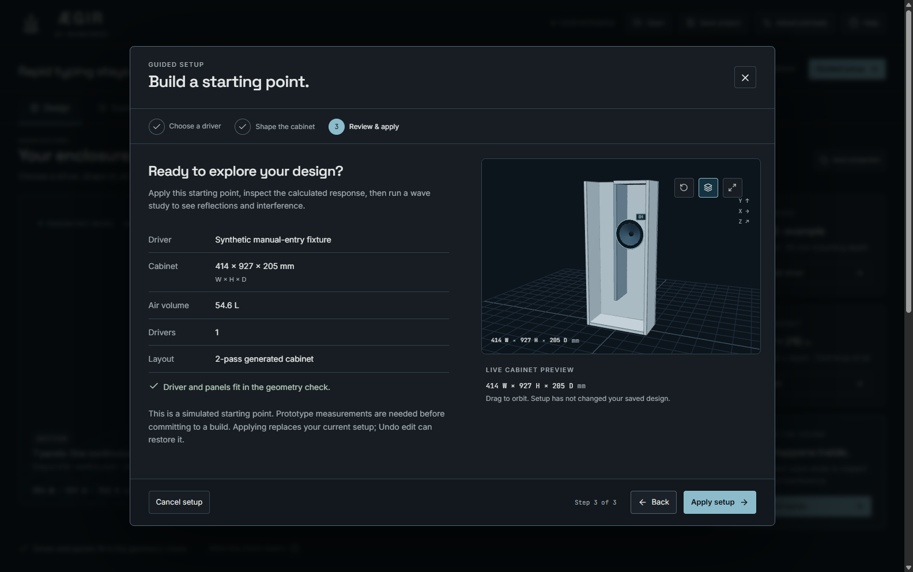
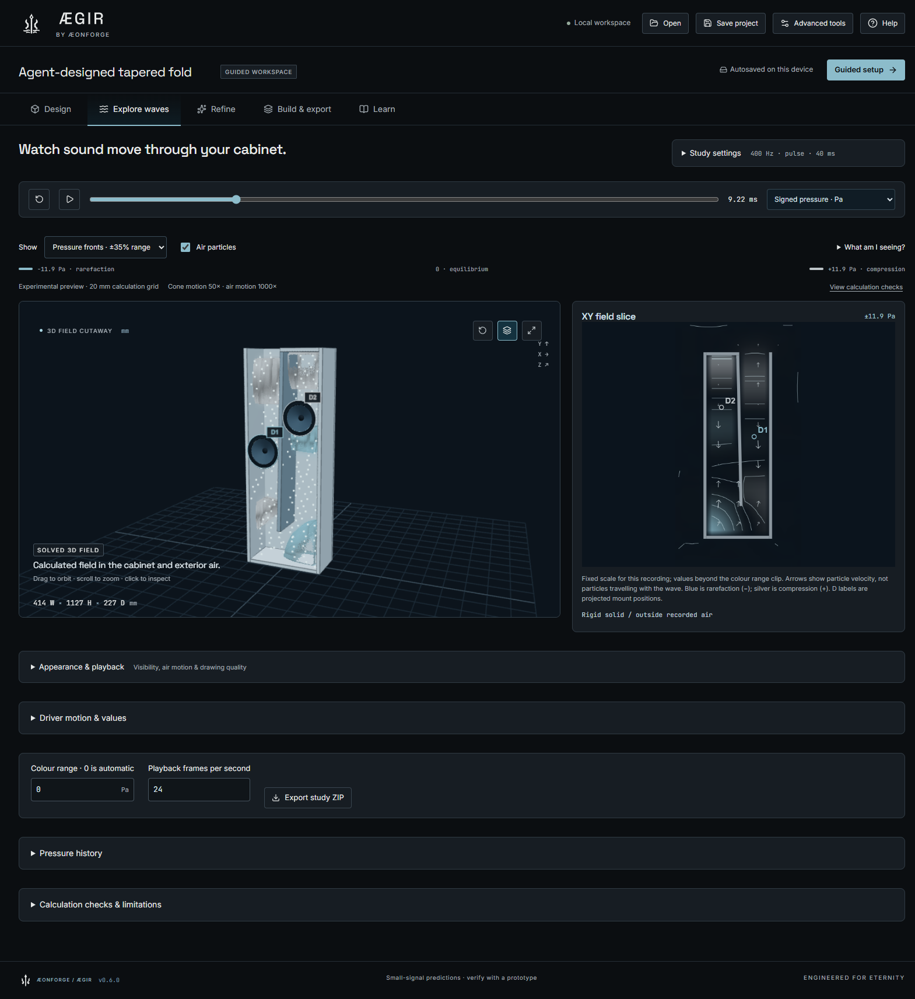
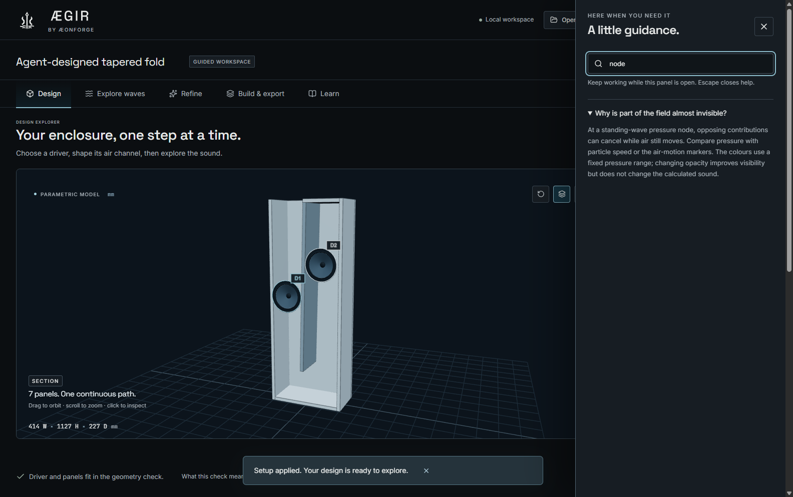

# Guided ÆGIR workflow

Implementation brief for 0.6.0, based on the owner's request and the ÆONFORGE
brand pack v3 at `C:\dev\aeonforge\brand`.

## Required outcomes and acceptance evidence

- A calm default workspace makes the next action clear. Design, wave exploration,
  refinement and export remain directly reachable. Verify real desktop screenshots
  at typical and minimum supported window sizes, without horizontal overflow.
- Guided setup supports current, synthetic example and user-specified drivers;
  explains required parameters; previews the enclosure; checks fit; and applies
  only on completion. Cancel must preserve the project. Custom layouts/multiple
  mounts must survive unless the user explicitly chooses a generated replacement.
  Concurrent edits must not be overwritten. Verify through desktop/MCP state.
- Context help is optional and keyboard accessible. Keep full engineering controls
  available through a persistent advanced mode and progressively disclosed details.
  Verify keyboard focus, wizard escape/back, help and advanced-mode persistence.
- The wave workflow prioritizes the calculated model, signal/run/play controls and
  a readable signed-pressure legend. Numerical settings, histories and diagnostics
  remain available without dominating the initial view. Verify new, legacy and
  stale recordings, multiple drivers and CPU/GPU playback in the actual renderer.
- Implement explicit pressure-to-opacity controls and optional gradient shading
  of recorded pressure fronts. These must preserve raw data, pressure sign, zero
  crossings and physical time. Verify observer invariance, CPU/GPU consistency and
  actual rendered changes without acoustic changes.
- Use supplied SVG identity masters, local Space Grotesk / Inter / JetBrains Mono,
  the pack's neutral/tide palette, readable type, focus and reduced-motion support.
  Retain font licences and document imported assets. Keep campaign imagery out of
  calculated-data views.
- Preserve editing, comparisons, search, MCP, CAD/export and existing projects.
  Verify representative complete GUI workflows, numerical tests and packaged app.
  Publish the implementation and run the updated desktop with the user's existing
  design, after backing up its profile.

## Initial audit

The old default presents two sidebars, tiny labels and dense technical metrics at
the same time as the 3D model and response chart. The wave page puts a long input
column, display controls and readouts ahead of the model. Most help is a large
method page or a hover title. Reset can replace a project immediately. Brand
identity was drawn locally rather than using the supplied masters; some chart
colours conflict with the current brand pack. These are workflow and hierarchy
problems as well as visual styling problems.

The redesign keeps the existing deterministic acoustic/CAD model. The guided
workflow introduces no AI-generated specifications or claims of validated output.

## Verification and review

The source acceptance checks pass: 51 numerical/service regressions, the guided
Electron workflow, the existing editing/library/comparison/search/export GUI
workflow, the two-driver CPU/GPU spatial harness, stdio MCP acceptance and exact
STEP/STL verification. The guided harness also checks rapid typing, actual loaded
font faces, canonical main-driver edits/search despite reordered mounts, raw-field
invariance after appearance changes, and default refinement/export layouts.

Reviewed native screenshots cover Design, driver/cabinet/review setup, help,
wave start/playback, refinement, export and Learn, including the supported
1120 × 760 minimum window. Ordinary labels and panel data were enlarged after
that review; optional numerical and workshop detail now expand on request.

Reproduce with `npm run build`, `npm test`, `npm run test:guided`,
`npm run test:e2e`, `npm run test:field`, `npm run test:mcp`, and `npm run test:cad`.
Run Electron suites sequentially for reproducible cold starts and CAD-runtime
probing on Windows. Evidence and synthetic screenshots are written under
`test-results/`; private runtime profiles are not committed.

Distribution verification runs the guided and spatial harnesses against the
unpacked executable using `AEGIR_TEST_APP`, `AEGIR_TEST_SERVER` and an isolated
`AEGIR_TEST_OUT`. The portable payload is compared byte-for-byte with that tested
application. Existing user data is backed up before upgrading, and the original
project/revision is compared after opening the packaged desktop. CI repeats the
build and 51 regressions from the published commit.

These checks verify implemented interactions, persistence, rendering and numerical
consistency. They do not establish a whole-product accessibility certification,
user-study outcome or independent acoustic validation.
